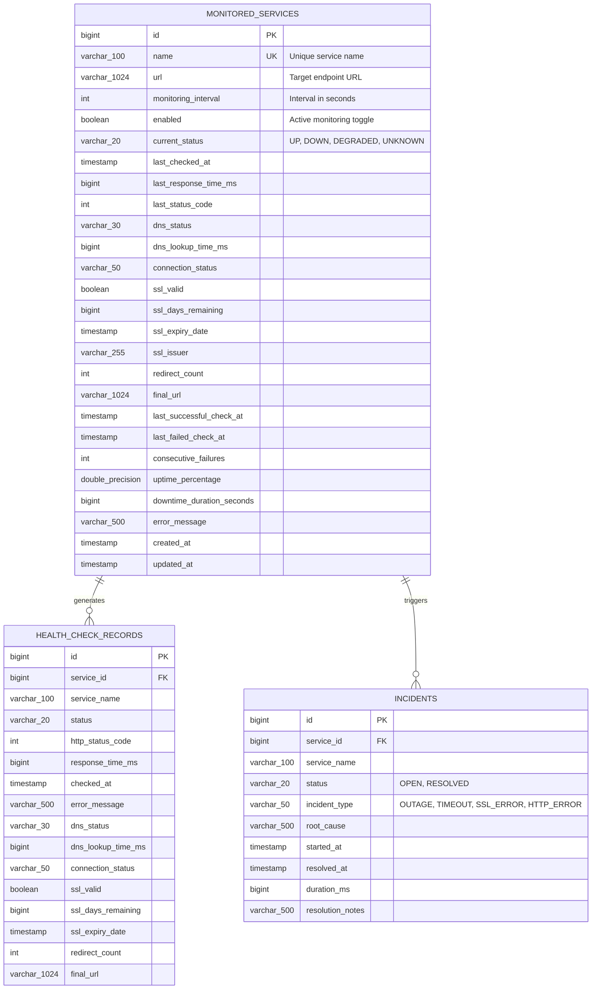

# Cloud Health Monitor — Database Schema Specification

## 1. Relational Entity Diagram

---

## 2. Table Schemas & Definitions

### 2.1 Table: `monitored_services`
Stores registered URL targets, configuration parameters, and the latest real-time health snapshot.

| Column | Type | Nullable | Constraints / Index | Description |
|---|---|---|---|---|
| `id` | `BIGINT` | No | Primary Key (Identity) | Unique identifier |
| `name` | `VARCHAR(100)` | No | Unique, Index (`idx_service_name`) | Display name |
| `url` | `VARCHAR(1024)` | No | Index (`idx_service_url`) | Target URL |
| `monitoring_interval` | `INTEGER` | No | Default 60 | Interval in seconds |
| `enabled` | `BOOLEAN` | No | Default `TRUE` | Whether checks are active |
| `current_status` | `VARCHAR(20)` | No | Index (`idx_service_status`) | UP, DOWN, DEGRADED, UNKNOWN |
| `last_checked_at` | `TIMESTAMP` | Yes | | Timestamp of last probe |
| `last_response_time_ms` | `BIGINT` | Yes | | Round-trip latency in ms |
| `last_status_code` | `INTEGER` | Yes | | HTTP status code received |
| `dns_status` | `VARCHAR(30)` | Yes | | SUCCESS, FAILED, SKIPPED |
| `dns_lookup_time_ms` | `BIGINT` | Yes | | Duration of DNS resolution |
| `connection_status` | `VARCHAR(50)` | Yes | | Socket state (e.g. CONNECTED) |
| `ssl_valid` | `BOOLEAN` | Yes | | TLS validity flag |
| `ssl_days_remaining` | `BIGINT` | Yes | | Days before certificate expires |
| `ssl_expiry_date` | `TIMESTAMP` | Yes | | Exact certificate expiry date |
| `ssl_issuer` | `VARCHAR(255)` | Yes | | Certificate Authority CN |
| `redirect_count` | `INTEGER` | Yes | | Number of safe redirects followed |
| `final_url` | `VARCHAR(1024)` | Yes | | Destination URL after redirects |
| `last_successful_check_at` | `TIMESTAMP` | Yes | | Timestamp of last UP state |
| `last_failed_check_at` | `TIMESTAMP` | Yes | | Timestamp of last DOWN/DEGRADED |
| `consecutive_failures` | `INTEGER` | No | Default 0 | Consecutive failure count |
| `uptime_percentage` | `DOUBLE PRECISION`| Yes | Default 100.0 | Rolling 24h uptime % |
| `downtime_duration_seconds`| `BIGINT` | Yes | Default 0 | Cumulative downtime duration |
| `error_message` | `VARCHAR(500)` | Yes | | Diagnostic error description |
| `created_at` | `TIMESTAMP` | No | Updatable=False | Entity creation timestamp |
| `updated_at` | `TIMESTAMP` | No | | Entity modification timestamp |

---

### 2.2 Table: `health_check_records`
Chronological time-series log of all individual check events.

| Column | Type | Nullable | Index | Description |
|---|---|---|---|---|
| `id` | `BIGINT` | No | Primary Key | Record identifier |
| `service_id` | `BIGINT` | No | Index (`idx_record_service_id`) | Monitored service FK |
| `service_name` | `VARCHAR(100)` | No | | Name snapshot |
| `status` | `VARCHAR(20)` | No | | UP, DOWN, DEGRADED |
| `http_status_code` | `INTEGER` | Yes | | Response code |
| `response_time_ms` | `BIGINT` | Yes | | Latency in ms |
| `checked_at` | `TIMESTAMP` | No | Index (`idx_record_checked_at`) | Probe timestamp |
| `error_message` | `VARCHAR(500)` | Yes | | Error message if failed |
| `dns_status` | `VARCHAR(30)` | Yes | | DNS result |
| `dns_lookup_time_ms` | `BIGINT` | Yes | | DNS latency |
| `connection_status` | `VARCHAR(50)` | Yes | | Connection state |
| `ssl_valid` | `BOOLEAN` | Yes | | SSL validity |
| `ssl_days_remaining` | `BIGINT` | Yes | | Days until SSL expiration |
| `ssl_expiry_date` | `TIMESTAMP` | Yes | | SSL expiration date |
| `redirect_count` | `INTEGER` | Yes | | Redirect hops |
| `final_url` | `VARCHAR(1024)` | Yes | | Final destination |

Composite Index: `idx_record_svc_time` on `(service_id, checked_at)` accelerates 24h/7d/30d statistical aggregation queries.

---

### 2.3 Table: `incidents`
Tracks outage lifecycles, root causes, durations, and recovery logs.

| Column | Type | Nullable | Description |
|---|---|---|---|
| `id` | `BIGINT` | No | Primary Key |
| `service_id` | `BIGINT` | No | Monitored service identifier |
| `service_name` | `VARCHAR(100)` | No | Service name at outage time |
| `status` | `VARCHAR(20)` | No | `OPEN`, `RESOLVED` |
| `incident_type` | `VARCHAR(50)` | No | `OUTAGE`, `TIMEOUT`, `SSL_ERROR`, `HTTP_ERROR` |
| `root_cause` | `VARCHAR(500)` | Yes | Diagnostic error reason |
| `started_at` | `TIMESTAMP` | No | Outage start timestamp |
| `resolved_at` | `TIMESTAMP` | Yes | Recovery timestamp |
| `duration_ms` | `BIGINT` | Yes | Total outage duration in ms |
| `resolution_notes` | `VARCHAR(500)` | Yes | Recovery details |

---

## 3. Database Compatibility & Migration

- **PostgreSQL:** Production dialect with auto-wiring via `DatabaseUrlEnvironmentPostProcessor.java`, handling SSL connection parameters (`sslmode=require`) on Render.
- **H2 in-memory:** Local test and embedded development mode (`jdbc:h2:mem:cloudhealth;DB_CLOSE_DELAY=-1;DB_CLOSE_ON_EXIT=FALSE`).
