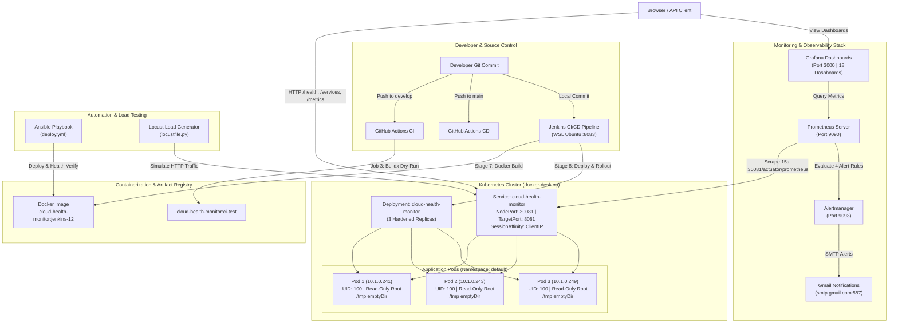

# Cloud Health Monitor — Deployment Architecture Documentation

**Project:** Cloud Health Monitor  
**Repository:** `Husenappa112/cloud-health-monitor-Devops-`  
**Branch:** `develop`  
**Commit:** `ed3d109509a0d2daaaeadcf4b979b60b66607c00`  
**Author:** Senior DevOps & Technical Documentation Engineer  

---

## 1. System Overview & Architecture Diagram

Cloud Health Monitor is an enterprise-grade cloud observability and microservices monitoring platform. It collects uptime, latency, thread state, and memory health across registered microservices while exposing standard Spring Boot Actuator and Micrometer metrics for Prometheus scraping and Grafana visualization.

### End-to-End Architecture Flow

---

## 2. Core Architecture Subsystems

### 1. Spring Boot Application
- **Runtime & Framework:** Java 21 LTS (OpenJDK / Temurin), Spring Boot 4.1.2.
- **Application Port:** `8081` (configured via `application.properties`).
- **REST Endpoints:**
  - `GET /health`: Instant liveness & readiness check (`{"status":"UP","application":"Cloud Health Monitor"}`).
  - `GET /services`: Registry of monitored microservices and health statuses.
  - `GET /metrics`: Aggregated uptime, check counts, and average response times.
  - `GET /actuator/prometheus`: Actuator/Micrometer metrics stream formatted for Prometheus scraping.
- **Test Suite:** 15 JUnit tests (14 integration tests in `ApiIntegrationTest.java` and 1 context load test in `CloudHealthMonitorApplicationTests.java`).

### 2. Docker Containerization & Security Hardening
- **Base Image:** Lightweight Linux container runtime (`eclipse-temurin:21-jre-alpine`).
- **Multi-Stage Build:** Dedicated build stage (`Dockerfile`) and runtime deployment (`Dockerfile.ci`).
- **Least-Privilege User:** Non-root execution (`USER appuser:appgroup`, UID `100`, GID `101`).
- **JVM Optimizations:** Container-aware memory flags (`-XX:+UseContainerSupport`, `-XX:MaxRAMPercentage=75.0`).

### 3. Kubernetes Orchestration (`docker-desktop`)
- **Deployment Manifest (`k8s/deployment.yaml`):**
  - **Replicas:** 3 pods for high availability and rolling update resiliency.
  - **Strategy:** `RollingUpdate` with `maxSurge: 1`, `maxUnavailable: 0` (zero-downtime rollouts).
  - **Pod SecurityContext:** `runAsNonRoot: true`, `runAsUser: 100`, `runAsGroup: 101`, `fsGroup: 101`, `seccompProfile: RuntimeDefault`.
  - **Container SecurityContext:** `allowPrivilegeEscalation: false`, `readOnlyRootFilesystem: true`, `capabilities: { drop: ["ALL"] }`.
  - **Storage:** Ephemeral `emptyDir` scratch volume mounted at `/tmp` satisfying Tomcat work directory write requirements while locking down the container root.
  - **Probes:** HTTP GET `/health` configured for `livenessProbe` (initial delay 30s) and `readinessProbe` (initial delay 15s).
- **Service Manifest (`k8s/service.yaml`):**
  - **Type:** `NodePort` mapping node port `30081` to container port `8081`.
  - **Load Balancing:** `sessionAffinity: ClientIP` with 3-hour timeout (`10800`s).

### 4. Prometheus Metrics Collection
- **Endpoint:** `http://localhost:9090` (Docker container `chm-prometheus`).
- **Scrape Configuration (`monitoring/prometheus/prometheus.yml`):**
  - Global scrape & evaluation interval: `15s`.
  - **Target 1 (`cloud-health-monitor`):** `chm-prometheus-test-20261115:8081/actuator/prometheus`.
  - **Target 2 (`cloud-health-monitor-kubernetes`):** `host.docker.internal:30081/actuator/prometheus`.

### 5. Alertmanager & Alert Rules
- **Endpoint:** `http://localhost:9093` (Docker container `chm-alertmanager`).
- **Rules File (`monitoring/prometheus/alert-rules.yml`):**
  1. `ApplicationDown`: Triggers `critical` alert if `up == 0` for 1 minute.
  2. `HighResponseTime`: Triggers `warning` alert if response time > 2s for 2 minutes.
  3. `HighCPUUsage`: Triggers `warning` alert if process CPU usage > 80% for 2 minutes.
  4. `HighJvmMemoryUsage`: Triggers `warning` alert if JVM heap usage > 80% for 2 minutes.
- **Routing (`monitoring/alertmanager/alertmanager.yml`):**
  - Receiver: `gmail-notifications`.
  - Smarthost: `smtp.gmail.com:587` with TLS and credential file authentication.

### 6. Grafana Dashboards
- **Namespace:** `monitoring` (Pod `grafana-7449dcd6c6-zkbcc`, port `3000`).
- **Storage:** Persisted via PVC `grafana-storage` (2Gi).
- **Datasource:** Prometheus at `http://host.docker.internal:9090`.
- **Pre-configured Dashboards (18 Dashboards):**
  - JVM Heap Memory, JVM Monitoring, Live Threads, Core Threads, Queued Tasks, Memory Allocated Per Second.
  - Application CPU Usage, System CPU Usage, System Load Average, System Resource Monitoring.
  - Active HTTP Requests, HTTP Requests Per Second, Total HTTP Requests, Average Response Time, Maximum Response Time.
  - `cloud-Mointer2` overview.

### 7. Jenkins CI/CD Pipeline
- **Runtime:** Native WSL Ubuntu service on port `8083`.
- **Pipeline Architecture (`Jenkinsfile`):**
  1. *Checkout:* Git checkout of branch `develop`.
  2. *Compile:* Maven clean compile.
  3. *Unit Tests:* Maven surefire execution (15 tests).
  4. *Code Quality:* Checkstyle violation scanning.
  5. *Package:* Spring Boot executable JAR generation.
  6. *Archive Artifacts:* Archive JAR and surefire reports.
  7. *Docker Build:* Container image tagged as `cloud-health-monitor:jenkins-${BUILD_NUMBER}`.
  8. *Deploy to Kubernetes:* Rolling update via `kubectl set image`, readiness probe wait (`kubectl wait --for=condition=ready`), NodePort validation (`192.168.65.3:30081`), and automatic rollback (`kubectl rollout undo`) on failure.
- **Latest Verified Build:** Build #12 (`SUCCESS`).

### 8. GitHub Actions Workflows
- **Trigger Separation:**
  - `ci.yml`: Triggers on `push` to `main` and `develop`. Executes Java 21 build, test, Checkstyle, and Docker Buildx dry-run.
  - `cd.yml`: Triggers only on `push` to `main` or manual `workflow_dispatch`. Builds and pushes to GHCR.
  - `pr-checks.yml`: Triggers on pull requests targeting `main` or `develop`. Enforces semantic titles, PR size labels, test verification, and OWASP dependency checks.
  - `release.yml`: Triggers only on version tags (`v*.*.*`). Builds release assets and generates GitHub releases.
  - `scheduled-health-check.yml`: Nightly automated health audit and NVD dependency vulnerability scan at 00:00 UTC.
- **Latest Verified Run:** Run #45591464696 on commit `ed3d109` (**SUCCESS** across all 3 jobs).

### 9. Ansible Deployment Automation
- **Playbook (`ansible/deploy.yml`):**
  - Target: `app_servers` inventory.
  - Role: `cloud_health_monitor`.
  - Tasks: Verifies Docker engine connection, provisions the container with resource limits and `JAVA_TOOL_OPTIONS`, and executes URI health retries against `/health`.

### 10. Locust Load & Performance Testing
- **Script (`locustfile.py`):**
  - Defines `CloudHealthMonitorUser` with randomized wait times (1–3s).
  - Simulates weighted traffic: 75% traffic to `/health` and 25% traffic to `/actuator/prometheus`.
  - Used for stress testing JVM garbage collection and validating Prometheus response time metrics.

---

## 3. DevOps Concept Clarifications (Interview Ready)

| Concept | Definition & Purpose | Implementation in Cloud Health Monitor |
| :--- | :--- | :--- |
| **Continuous Integration (CI)** | Automatically building, compiling, and testing code changes upon commit to catch defects early. | GitHub Actions `ci.yml` & Jenkins Stages 1–6 (Compile, 15 Unit Tests, Checkstyle). |
| **Continuous Deployment (CD)** | Automatically packaging and deploying verified build artifacts to staging or production environments without manual intervention. | GitHub Actions `cd.yml` (GHCR image publish) & Jenkins Stages 7–8 (K8s rollout). |
| **Orchestration** | Managing container lifecycles, scaling, networking, self-healing, and rolling updates across clusters. | Kubernetes (`k8s/deployment.yaml`) maintaining 3 replicas, health probes, and NodePort 30081. |
| **Monitoring** | Passively gathering and aggregating numerical metrics over time to observe system behavior and health. | Prometheus scraping JVM and HTTP metrics every 15s; Grafana rendering 18 dashboards. |
| **Alerting** | Proactively evaluating metric thresholds and dispatching notifications to on-call engineers when anomalies occur. | Alertmanager evaluating 4 alert rules (`ApplicationDown`, CPU, Memory, Latency) and routing to Gmail. |
| **Load Testing** | Artificially simulating concurrent user traffic to measure scalability, bottlenecks, and latency degradation under stress. | Locust (`locustfile.py`) generating concurrent simulated users against `/health` and `/actuator/prometheus`. |
