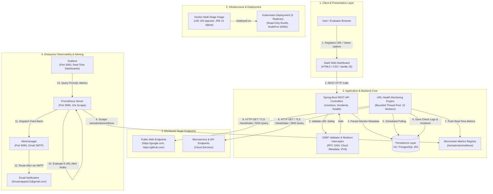

# Cloud Health Monitor — College Demonstration, Technical Interview & Architecture Guide

**Project:** Cloud Health Monitor Platform  
**Repository:** [Husenappa112/cloud-health-monitor-Devops-](https://github.com/Husenappa112/cloud-health-monitor-Devops-)  
**Branch:** `develop`  
**Target Audience:** College Evaluators, Technical Interviewers, DevOps Assessors  
**Primary URLs:**
- Web Dashboard: [http://localhost:8081/index.html](http://localhost:8081/index.html) (Docker) or [http://localhost:30081/index.html](http://localhost:30081/index.html) (Kubernetes)
- Prometheus UI: [http://localhost:9090](http://localhost:9090)
- Alertmanager UI: [http://localhost:9093](http://localhost:9093)
- Grafana UI: [http://localhost:3000](http://localhost:3000)

---

## 1. Project Introduction

**Cloud Health Monitor** is an enterprise-grade, URL-based application availability and performance monitoring platform. Similar to commercial synthetic monitoring platforms like Pingdom, Datadog Synthetics, and BetterUptime, it allows engineers and system administrators to register publicly accessible HTTP/HTTPS application endpoints, microservices, and web APIs to continuously monitor:
- **Availability:** HTTP status code validation (2xx/3xx/4xx/5xx).
- **Latency:** End-to-end response times with automated degradation thresholds.
- **SSL/TLS Certificate Validity:** Days remaining until certificate expiration and issuer chain verification.
- **DNS Resolution Health:** DNS lookup duration in milliseconds and domain failure detection.
- **Incident Lifecycle:** Automated incident triggering upon downtime and automatic resolution when health recovers.

---

## 2. Problem Statement

In distributed cloud and microservice architectures, silent failures, DNS misconfigurations, expiring TLS certificates, and latency degradation frequently go unnoticed until customers complain. Organizations need:
1. **Automated Continuous Verification:** Synthetic probing without human intervention.
2. **Proactive Certificate Alerts:** Advance warning before HTTPS certificates expire and cause browser security warnings.
3. **Defense-in-Depth Security:** The ability for users to monitor arbitrary URLs without introducing Server-Side Request Forgery (SSRF) vulnerabilities that could expose internal cloud networks.
4. **Cloud-Native Resilience:** Containerized packaging running on hardened Kubernetes clusters with non-root privileges and zero-downtime rolling updates.

---

## 3. System Architecture & Component Data Flow



### Data Flow Responsibility Breakdown
| Subsystem | Generates Data | Stores Data | Collects Data | Visualizes Data |
|---|---|---|---|---|
| **Health Probes** | `UrlHealthMonitoringEngine` | JPA `check_logs` table | `ScheduledMonitoringService` | Dashboard Monitor Table |
| **Outage Incidents** | `IncidentManagementService` | JPA `incidents` table | Event listeners on DOWN/UP | Dashboard Incidents Panel |
| **System Telemetry** | Micrometer MeterRegistry | Prometheus TSDB | Prometheus Scraper (15s) | Grafana & Prometheus UI |
| **Alert Routing** | Prometheus Alert Engine | Alertmanager In-Memory | Alertmanager Receivers | Alertmanager UI & Email |

---

## 4. Why Spring Boot & Java 21 Are Used

- **Java 21 Virtual Threads & Modern HTTP Client:** Uses Java 21's non-blocking, modern `java.net.http.HttpClient` with fine-grained connect (3s) and request (5s) timeouts, preventing slowloris attacks and thread starvation.
- **Spring Boot 4.x Production Stack:** Provides battle-tested embedded Tomcat, declarative Spring Data JPA repositories, uniform validation frameworks, and Spring Boot Actuator for enterprise telemetry.
- **Zero-Dependency Security:** Core SSRF validation is implemented with clean Java standard library primitives without external fragile dependencies.

---

## 5. How URL Monitoring Works

Every configured interval (30s, 60s, 120s, 300s):
1. **Hostname & DNS Inspection:** `DnsInspector` resolves the domain and records duration in milliseconds. If unknown host, marks `DOWN` immediately.
2. **SSRF Guard:** Before establishing connection, `SsrfValidator` resolves IP and confirms it is not loopback, private IPv4/IPv6, or cloud metadata.
3. **SSL/TLS Handshake:** `SslCertificateInspector` connects via TLS, extracts peer certificate, calculates exact days to expiration, and checks issuer CN.
4. **HTTP Execution:** Sends `GET` with bounded timeouts. Evaluates status code:
   - $200 \le \text{Code} < 400$ and latency $\le$ threshold $\rightarrow$ **UP**
   - $200 \le \text{Code} < 400$ and latency $>$ threshold $\rightarrow$ **DEGRADED**
   - $400 \le \text{Code} < 600$ or timeout or connection failure $\rightarrow$ **DOWN**
5. **State Machine & Incident Transition:** If status transitions from UP $\rightarrow$ DOWN, automatically opens an incident. When status transitions from DOWN $\rightarrow$ UP, automatically resolves the incident and calculates outage duration.

---

## 6. How Data Flows Through the Application

1. **User Action:** Evaluator clicks "Add Monitor" in the dashboard.
2. **REST API Ingestion:** `MonitorController` receives `CreateMonitorRequest`, validates DTO using `@Valid`.
3. **Security Gate:** `SsrfValidator.validateUrl(url)` confirms target safety.
4. **JPA Persistence:** Stored in H2/PostgreSQL database via `MonitoredServiceRepository`.
5. **Immediate Probe:** Engine runs initial health probe asynchronously and records results in `HealthCheckRecord`.
6. **Telemetry Update:** `PrometheusMetricsExportService` updates gauges for Prometheus scraper.

---

## 7. Why Prometheus Is Used

Prometheus is the de facto cloud-native metric monitoring standard:
- **Pull-Based Model:** Scrapes `/actuator/prometheus` on a deterministic 15-second cadence.
- **Dimensional Data Model:** Employs key-value label dimensions (`service="Google Probe"`, `status="UP"`).
- **PromQL Engine:** Enables sophisticated alerting queries like `monitored_service_response_time_seconds > 2` or `monitored_service_ssl_expiry_days < 7`.

---

## 8. What Grafana Displays

Grafana connects to Prometheus and provides real-time visualization:
- **Global Uptime Gauges:** Current health percentage across all monitored services.
- **Latency Distribution:** Real-time line graphs showing response times and latency spikes.
- **SSL Certificate Countdown:** Bar gauges tracking days remaining until certificates expire.
- **JVM & Infrastructure Health:** CPU load, heap memory utilization, active thread counts.

---

## 9. How Docker and Kubernetes Are Used

### Docker
- Multi-stage build (`eclipse-temurin:21-jdk-alpine` builder $\rightarrow$ `eclipse-temurin:21-jre-alpine` runtime).
- Non-root user `appuser` (UID 100, GID 101).
- Minimal production footprint (~250MB).

### Kubernetes
- **High Availability:** 3 replica pods managed by `Deployment` controller.
- **Zero-Downtime Rollout:** `RollingUpdate` strategy (maxSurge: 1, maxUnavailable: 0).
- **Self-Healing Probes:**
  - `startupProbe`: Allows 200s for Spring JPA schema initialization.
  - `livenessProbe`: Verifies `/health` every 10s to restart hung containers.
  - `readinessProbe`: Removes unready pods from Service endpoints.
- **Hardened Security Context:** Restricted Pod Security Standard (read-only rootfs, non-root, drop ALL capabilities, runtime default seccomp).
- **Service & Session Affinity:** NodePort `30081` with `sessionAffinity: ClientIP` ensuring consistent user sessions.

---

## 10. How Alerts and Incidents Work

The platform features a dual-layer alerting architecture:
1. **Application-Level Incident Tracking:**
   - Auto-creates `Incident` entity in database when service goes DOWN.
   - Categorizes incidents: `HTTP_ERROR`, `TIMEOUT`, `DNS_FAILURE`, `SSL_ERROR`.
   - Records start timestamp, end timestamp, resolution duration, and root cause.
2. **Prometheus & Alertmanager Alerting:**
   - Evaluates 6 active PromQL rules.
   - Fires alerts to Alertmanager on port `9093`.
   - Alertmanager groups, deduplicates, and dispatches email notifications via Gmail SMTP.

---

## 11. How SSRF Protection Works

Because users can enter arbitrary URLs, attackers might attempt to access internal microservices or cloud credentials. The platform defends against this at multiple layers:

| Attack Vector | Attacker Payload | Platform Defense | Response |
|---|---|---|---|
| **Localhost Scanning** | `http://localhost:8080/admin` | Domain blacklist filter | HTTP 400 Bad Request |
| **Loopback IP** | `http://127.0.0.1:9090` | `InetAddress.isLoopbackAddress()` | HTTP 400 Bad Request |
| **Private Subnet** | `http://10.0.0.1/internal` | RFC 1918 range check (`10.0.0.0/8`, `172.16.0.0/12`, `192.168.0.0/16`) | HTTP 400 Bad Request |
| **Cloud Metadata** | `http://169.254.169.254/latest/meta-data` | Explicit link-local check (`169.254.169.254`) | HTTP 400 Bad Request |
| **IPv6 Attacks** | `http://[::1]:8080`, `http://[fc00::1]` | IPv6 loopback, ULA (`fc00::/7`), link-local (`fe80::/10`) | HTTP 400 Bad Request |
| **Protocol Smuggling** | `file:///etc/passwd`, `gopher://` | Strict scheme whitelist (`http`, `https` only) | HTTP 400 Bad Request |
| **Open Redirect SSRF** | `https://safe.com/redirect?to=169.254.169.254` | `HttpClient.Redirect.NEVER` + manual hop re-validation | Blocked on redirect hop |

---

## 12. Database Architecture

The platform uses Spring Data JPA with entity-relationship modeling:
1. **`MonitoredService`:** Stores monitor configuration, URL, polling interval, degraded threshold, current status, and SSL/DNS metadata.
2. **`HealthCheckRecord`:** Stores historical check logs (status, latency, HTTP code, SSL days, DNS time, timestamp).
3. **`Incident`:** Stores outage incidents (status OPEN/RESOLVED, incident type, root cause, start/end timestamps, duration).

**Persistence Profiles:**
- **Default Profile (In-Memory H2):** `jdbc:h2:mem:cloudhealth` for rapid testing and CI.
- **Disk-File Profile (Persistent H2):** `jdbc:h2:file:./data/cloudhealth;DB_CLOSE_DELAY=-1` for local durability.
- **PostgreSQL Profile (Production):** Configured via `application-postgres.properties` with environment variables for enterprise relational databases.

---

## 13. API Demonstration Commands

Open PowerShell or terminal and execute:

### 1. Register a Healthy Public Monitor
```powershell
$body = '{"name":"Google Health","url":"https://google.com","checkIntervalSeconds":30,"timeoutMs":5000,"degradedLatencyThresholdMs":800}'
$resp = Invoke-RestMethod -Uri "http://localhost:8081/monitors" -Method Post -Body $body -ContentType "application/json"
Write-Host "Created Monitor ID: $($resp.id)"
```

### 2. Trigger Real-Time On-Demand Check
```powershell
Invoke-RestMethod -Uri "http://localhost:8081/monitors/1/check" -Method Post | ConvertTo-Json
```

### 3. Query Monitor Overview & Analytics
```powershell
Invoke-RestMethod -Uri "http://localhost:8081/monitors/overview" | ConvertTo-Json
```

### 4. Demonstrate SSRF Blocking
```powershell
# Attempting to scan loopback
try {
    Invoke-RestMethod -Uri "http://localhost:8081/monitors" -Method Post -Body '{"name":"Evil Loopback","url":"http://127.0.0.1:8080"}' -ContentType "application/json"
} catch {
    Write-Host "Blocked! Status: $($_.Exception.Response.StatusCode.value__)"
}

# Attempting to steal cloud metadata
try {
    Invoke-RestMethod -Uri "http://localhost:8081/monitors" -Method Post -Body '{"name":"Evil Cloud","url":"http://169.254.169.254/latest/meta-data"}' -ContentType "application/json"
} catch {
    Write-Host "Blocked! Status: $($_.Exception.Response.StatusCode.value__)"
}
```

### 5. Check Prometheus Custom Metrics
```powershell
Invoke-RestMethod -Uri "http://localhost:9090/api/v1/query?query=monitored_service_up" | ConvertTo-Json -Depth 4
```

---

## 14. Expected Outputs

### Health Check Output
```json
{
  "id": 1,
  "serviceId": 1,
  "status": "UP",
  "httpStatusCode": 200,
  "latencyMs": 209,
  "sslDaysRemaining": 61,
  "sslIssuer": "CN=WE2",
  "dnsLookupMs": 1,
  "checkedAt": "2026-11-25T18:00:00Z"
}
```

### Overview Analytics Output
```json
{
  "totalMonitors": 2,
  "upCount": 1,
  "downCount": 1,
  "degradedCount": 0,
  "overallUptimePercentage": 66.67,
  "totalChecks": 35,
  "openIncidents": 1,
  "resolvedIncidents": 1
}
```

---

## 15. Common Errors & Troubleshooting

| Symptom | Root Cause | Resolution |
|---|---|---|
| **HTTP 500 on static assets** | Missing exception mapping for Spring Boot 4 `NoResourceFoundException` | Explicit `@ExceptionHandler` mapping returning HTTP 404 in `GlobalExceptionHandler.java`. |
| **HTTP 500 on malformed JSON** | Missing mapping for `HttpMessageNotReadableException` | Explicit `@ExceptionHandler` mapping returning HTTP 400 Bad Request. |
| **Kubernetes Pod Startup Probe Failure** | Heavy JPA/schema initialization on constrained CPU | Set `failureThreshold: 20` with `periodSeconds: 10` (allows 200s for container warm-up). |
| **Prometheus Target DOWN** | Target container on different Docker network | Run `docker network connect --alias <alias> <network> <container>` to bridge networks. |
| **Grafana Dashboard No Data** | Datasource pointed to unreachable host | Ensure Prometheus datasource URL is set to `http://chm-prometheus:9090` or `http://host.docker.internal:9090`. |
