# Cloud Health Monitor — Technical Demonstration & Interview Walkthrough Guide

**Target Audience:** Interviewers, Technical Assessors, Academic Panel  
**Duration:** 10–15 Minutes  
**Prerequisites:** Environment running (Docker Desktop active, K8s 3/3 pods ready, Prometheus & Grafana online)  

---

## Demonstration Sequence Overview

```mermaid
flowchart LR
    S1["1. Intro & Business Goal"] --> S2["2. Health & REST API"]
    S2 --> S3["3. Metrics & Actuator"]
    S3 --> S4["4. Docker Security"]
    S4 --> S5["5. K8s 3 Replicas"]
    S5 --> S6["6. Prometheus Scrapes"]
    S6 --> S7["7. Grafana 18 Dashboards"]
    S7 --> S8["8. Alertmanager & Email"]
    S8 --> S9["9. Jenkins Pipeline"]
    S9 --> S10["10. GitHub Actions CI"]
    S10 --> S11["11. Ansible & Locust"]
```



---

### Stage 1: Introduction & Project Objective (1 min)
- **Objective:** Introduce Cloud Health Monitor as a resilient microservices monitoring and health aggregator built with Spring Boot 4, Java 21, and Kubernetes.
- **Key Talking Points:**
  - Modern cloud-native architectures require automated telemetry, self-healing orchestration, and strict security posture (least privilege, non-root, read-only root).
  - This project implements an automated CI/CD pipeline (GitHub Actions + Jenkins) and full observability (Prometheus, Alertmanager, Grafana).

---

### Stage 2: Application Health & Registered Services (1.5 min)
- **Action:** Open or curl the application endpoints.
- **Commands / URLs:**
  ```bash
  curl -i http://localhost:30081/health
  curl -s http://localhost:30081/services
  curl -s http://localhost:30081/metrics
  ```
- **Expected Output:**
  ```json
  {"status":"UP","application":"Cloud Health Monitor"}
  ```
- **What It Proves:**
  - The application is responsive on Kubernetes NodePort `30081`.
  - Service registry and operational metrics tracking endpoints are active.

---

### Stage 3: Prometheus Actuator Telemetry (1 min)
- **Action:** Inspect the raw Actuator Prometheus stream.
- **Command / URL:**
  ```bash
  curl -s http://localhost:30081/actuator/prometheus | head -n 25
  ```
- **Expected Output:** Standard OpenMetrics formatted stream (`jvm_memory_used_bytes`, `system_cpu_usage`, `http_server_requests_seconds_count`).
- **What It Proves:**
  - Spring Boot Actuator and Micrometer are configured to expose high-resolution JVM telemetry for external scrapers.

---

### Stage 4: Docker Container Security Inspection (1.5 min)
- **Action:** Inspect the container runtime to prove least-privilege security controls.
- **Commands:**
  ```bash
  # Check image tags
  docker images cloud-health-monitor:jenkins-12

  # Check runtime non-root execution inside container
  docker exec <container-id> id
  ```
- **Expected Output:**
  `uid=100(appuser) gid=101(appgroup) groups=101(appgroup)`
- **What It Proves:**
  - The container does not run as root (`uid=0`), eliminating container breakout vulnerabilities.
  - Runtime image matches verified Jenkins Build #12 (`sha256:6e804ab1da98...`).

---

### Stage 5: Kubernetes Orchestration & Zero-Downtime Resilience (2 min)
- **Action:** Demonstrate multi-replica deployment, service load balancing, and security context.
- **Commands:**
  ```bash
  kubectl get deployments -n default
  kubectl get pods -n default -o wide
  kubectl get svc -n default
  ```
- **Expected Output:**
  - `cloud-health-monitor` showing `3/3` Ready replicas distributed across virtual IPs.
  - Service NodePort mapping `30081` with `sessionAffinity: ClientIP`.
- **What It Proves:**
  - High availability: traffic is load-balanced across 3 pods.
  - Zero-downtime rolling updates (`maxSurge: 1, maxUnavailable: 0`).
  - Pod security contexts enforce `readOnlyRootFilesystem: true` with `/tmp` mounted via `emptyDir`.

---

### Stage 6: Prometheus Metrics & Scrape Targets (1.5 min)
- **Action:** Open Prometheus UI at `http://localhost:9090/targets`.
- **Expected View:**
  - Target 1: `cloud-health-monitor` (`UP`).
  - Target 2: `cloud-health-monitor-kubernetes` (`UP`, endpoint `http://host.docker.internal:30081/actuator/prometheus`).
  - Graphing: Query `jvm_memory_used_bytes` or `rate(http_server_requests_seconds_count[1m])`.
- **What It Proves:**
  - Prometheus pull-architecture is continuously ingesting metrics from Kubernetes pods every 15 seconds.

---

### Stage 7: Grafana Dashboards Visualization (2 min)
- **Action:** Open Grafana at `http://localhost:3000`.
- **Highlights to Show:**
  - Exactly 18 dashboards available in the dashboard browse tree.
  - Show *JVM Heap Memory*, *System CPU Usage*, and *Active HTTP Requests*.
  - Show real-time gauges and time-series line graphs populating from Prometheus.
- **What It Proves:**
  - Metrics are converted into actionable visual dashboards for operations teams.
  - Persistent storage (`2Gi` PVC) preserves dashboards across pod restarts.

---

### Stage 8: Alertmanager & Gmail Notification Architecture (1 min)
- **Action:** Open `http://localhost:9090/alerts` and `http://localhost:9093`.
- **Expected View:**
  - 4 alert rules loaded: `ApplicationDown`, `HighResponseTime`, `HighCPUUsage`, `HighJvmMemoryUsage`.
  - Alertmanager routing tree configured with receiver `gmail-notifications` and Gmail SMTP (`smtp.gmail.com:587`).
- **What It Proves:**
  - Proactive alerting: engineers are automatically notified via email when critical thresholds are breached.

---

### Stage 9: Jenkins CI/CD Pipeline (Build #12) (1.5 min)
- **Action:** Open Jenkins UI at `http://localhost:8083/job/Cloud-Health-Monitor/`.
- **Highlights to Show:**
  - Stage View: 8 stages (Checkout -> Compile -> Unit Tests -> Code Quality -> Package -> Archive -> Docker Build -> Deploy to Kubernetes).
  - Show Build #12 status: `SUCCESS`.
  - Explain automated rollback mechanism: if Kubernetes rollout or health verification fails, Jenkins automatically invokes `kubectl rollout undo`.
- **What It Proves:**
  - Automated continuous delivery pipeline from source checkout to live cluster deployment with safety rollback gates.

---

### Stage 10: Remote GitHub Actions CI Verification (1 min)
- **Action:** Open GitHub Actions in browser: [Workflow Run 45591464696](https://github.com/Husenappa112/cloud-health-monitor-Devops-/actions/runs/45591464696).
- **Highlights to Show:**
  - Run #45591464696 on commit `ed3d109` on branch `develop`.
  - All 3 jobs green: *Build & Unit Tests (Java 21)*, *Code Quality Check*, and *Docker Build Validation*.
- **What It Proves:**
  - Upstream developer push triggers automated cloud validation, unit testing, and Docker Buildx compilation on GitHub infrastructure.

---

### Stage 11: Ansible Automation & Locust Load Simulation (1 min)
- **Action:** Show `ansible/deploy.yml` and `locustfile.py`.
- **Highlights to Show:**
  - Ansible: Idempotent container lifecycle configuration and health probe retries.
  - Locust: User behavior simulation distributing traffic across `/health` and `/actuator/prometheus`.
- **What It Proves:**
  - Demonstrates infrastructure-as-code automation and pre-release stress/performance testing capabilities.

---

## Summary of Demonstration Proofs

| Capability | Demonstration Evidence | Interview Takeaway |
| :--- | :--- | :--- |
| **Microservices Development** | Spring Boot 4 REST API, Java 21, Actuator | Strong backend foundations & observability standards |
| **Container Security** | Non-root `appuser:100:101`, Alpine base | DevSecOps principles baked into image creation |
| **Cloud Orchestration** | Kubernetes 3 Replicas, NodePort, Health Probes | Production orchestration & self-healing resilience |
| **Full-Stack Observability** | Prometheus (15s scrapes), Alertmanager, Grafana (18 dashboards) | Real-time monitoring & incident detection |
| **Dual CI/CD Pipelines** | GitHub Actions (Cloud CI) + Jenkins (Local CD with auto-rollback) | End-to-end deployment automation & release governance |
| **IaC & Performance Testing**| Ansible playbooks + Locust traffic generator | Automated deployment and scalability validation |
