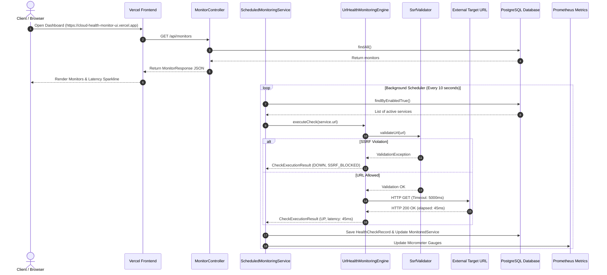

# Cloud Health Monitor — System Architecture Specification

## 1. Architectural Overview

**Cloud Health Monitor** is a distributed, reactive URL availability and infrastructure observability platform designed to monitor web applications, REST APIs, and HTTPS endpoints.

### Core Architectural Principles
1. **Zero-Trust Network Probing:** Never trust user-supplied URLs. Validate every target against SSRF rules, IP blacklists, and DNS resolution policies before opening sockets.
2. **Decoupled Edge Presentation:** The frontend operates independently on a global Content Delivery Network (Vercel) while backend engines run on elastic container infrastructure (Render / Kubernetes).
3. **Non-Blocking Background Concurrency:** Health check polling uses an isolated thread pool so that slow target responses do not degrade API responsiveness or block other monitors.
4. **Comprehensive Diagnostic Depth:** Each execution records full multidimensional health metrics (HTTP status code, round-trip time, DNS resolution duration, SSL validity, days until certificate expiration, connection state, and redirect chains).

---

## 2. Layered Component Architecture

```
┌─────────────────────────────────────────────────────────────────────────────┐
│                       PRESENTATION TIER (Vercel Edge)                       │
│                                                                             │
│  ┌───────────────────────┐  ┌───────────────────────┐  ┌─────────────────┐  │
│  │ Single-Page Dashboard │  │ HTML5 Canvas Sparkline│  │  Status Page UI │  │
│  │ (index.html, app.js)  │  │ (Latency Trend Chart) │  │  (Public View)  │  │
│  └───────────────────────┘  └───────────────────────┘  └─────────────────┘  │
└──────────────────────────────────────┬──────────────────────────────────────┘
                                       │ HTTPS / CORS REST API
                                       ▼
┌─────────────────────────────────────────────────────────────────────────────┐
│                 APPLICATION GATEWAY & CONTROLLER TIER (Spring Boot 4)       │
│                                                                             │
│  ┌───────────────────────┐  ┌───────────────────────┐  ┌─────────────────┐  │
│  │   MonitorController   │  │  DashboardController  │  │IncidentControll.│  │
│  │ (/api/monitors)       │  │ (/api/dashboard)      │  │ (/incidents)    │  │
│  └───────────────────────┘  └───────────────────────┘  └─────────────────┘  │
│  ┌───────────────────────┐  ┌───────────────────────┐  ┌─────────────────┐  │
│  │   HealthController    │  │   WebCorsConfig       │  │GlobalException. │  │
│  │ (/health)             │  │ (CORS Allowed Origins)│  │ (RFC 7807 Error)│  │
│  └───────────────────────┘  └───────────────────────┘  └─────────────────┘  │
└──────────────────────────────────────┬──────────────────────────────────────┘
                                       │
                                       ▼
┌─────────────────────────────────────────────────────────────────────────────┐
│                    BUSINESS LOGIC & ENGINE TIER                             │
│                                                                             │
│  ┌───────────────────────────────────────────────────────────────────────┐  │
│  │                     ScheduledMonitoringService                        │  │
│  │        (FixedThreadPool-10, Cron / FixedDelay Tick: 10s)              │  │
│  └───────────────────────────────────┬───────────────────────────────────┘  │
│                                      │                                      │
│                                      ▼                                      │
│  ┌───────────────────────────────────────────────────────────────────────┐  │
│  │                     UrlHealthMonitoringEngine                         │  │
│  │    SSRF Guard ──► DNS Inspector ──► SSL Inspector ──► HTTP Client     │  │
│  └───────────────────────────────────┬───────────────────────────────────┘  │
│                                      │                                      │
│         ┌────────────────────────────┼────────────────────────────┐         │
│         ▼                            ▼                            ▼         │
│  ┌───────────────┐            ┌───────────────┐            ┌──────────────┐ │
│  │ SsrfValidator │            │ DnsInspector  │            │SslCertificate│ │
│  │ (CIDR Filter) │            │ (InetAddress) │            │  Inspector   │ │
│  └───────────────┘            └───────────────┘            └──────────────┘ │
└──────────────────────────────────────┬──────────────────────────────────────┘
                                       │
                                       ▼
┌─────────────────────────────────────────────────────────────────────────────┐
│                         DATA PERSISTENCE & TELEMETRY                        │
│                                                                             │
│  ┌───────────────────────────────────────┐  ┌────────────────────────────┐  │
│  │          Spring Data JPA              │  │     Prometheus Exporter    │  │
│  │  - MonitoredServiceRepository         │  │  - monitored_service_up    │  │
│  │  - HealthCheckRecordRepository        │  │  - response_time_seconds   │  │
│  │  - IncidentRepository                 │  │  - ssl_expiry_days         │  │
│  └───────────────────┬───────────────────┘  └─────────────┬──────────────┘  │
│                      │                                    │                 │
│                      ▼                                    ▼                 │
│  ┌───────────────────────────────────────┐  ┌────────────────────────────┐  │
│  │       PostgreSQL (Render) / H2        │  │    Prometheus & Grafana    │  │
│  └───────────────────────────────────────┘  └────────────────────────────┘  │
└─────────────────────────────────────────────────────────────────────────────┘
```

---

## 3. Data Flow Model



---

## 4. Security Architecture & Threat Mitigation

### 4.1 Server-Side Request Forgery (SSRF) Defense
When arbitrary users enter URLs, attackers attempt to probe internal networks or cloud metadata. The `SsrfValidator` applies strict multi-stage filtering:
1. **Scheme Whitelist:** Strictly permits `http` and `https`.
2. **Port Restrictions:** Allows ports 80, 443, 8080, 8443, 8000, 3000, 5000, 9000; blocks sensitive infrastructure ports (e.g. 22 SSH, 25 SMTP, 2375 Docker, 6379 Redis).
3. **IP Range Blacklist:** Resolves DNS to IP addresses before initiating socket connections, blocking:
   - Loopback: `127.0.0.0/8`
   - RFC 1918 Private: `10.0.0.0/8`, `172.16.0.0/12`, `192.168.0.0/16`
   - Link-Local / Cloud Metadata: `169.254.0.0/16` (protects `169.254.169.254`)
   - IPv6: `::1`, `fc00::/7`, `fe80::/10`
4. **Safe Redirect Validation:** Enforces `HttpClient.Redirect.NEVER`. Redirect locations (`3xx`) are resolved and re-submitted through the `SsrfValidator` before traversal.

---

## 5. Deployment & Network Topology

```
                  INTERNET
                     │
         ┌───────────┴───────────┐
         ▼                       ▼
  [ Vercel CDN ]          [ Render Cloud ]
  (Static Frontend)       (Spring Boot Container)
  Port: 443               Port: 8081 / $PORT
         │                       │
         └─────── (CORS) ────────┘
                                 │
                                 ▼
                         [ Render Managed PostgreSQL ]
                         Port: 5432 (SSL Required)
```
